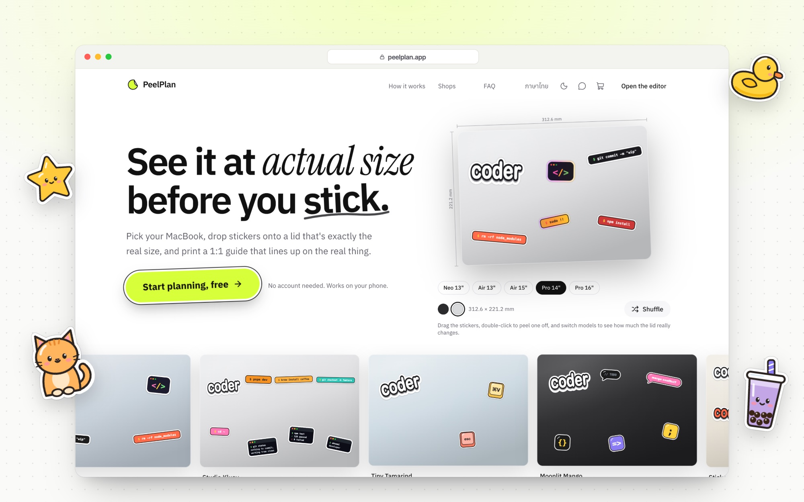
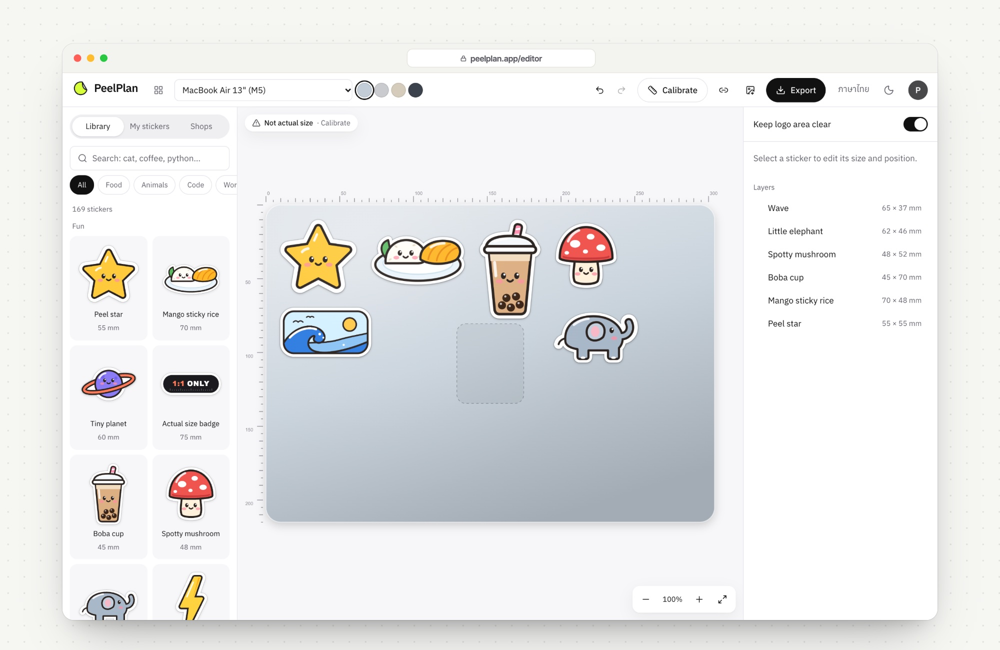
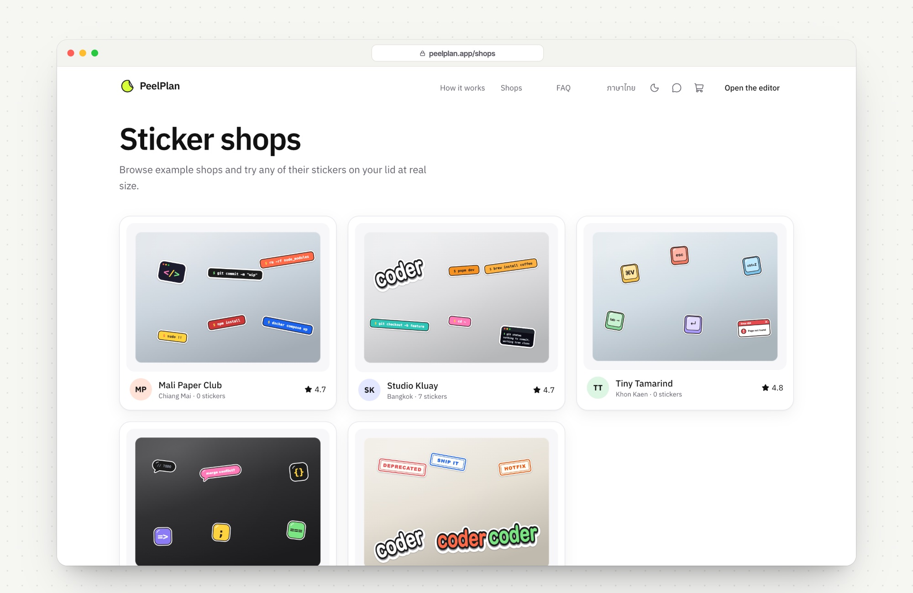
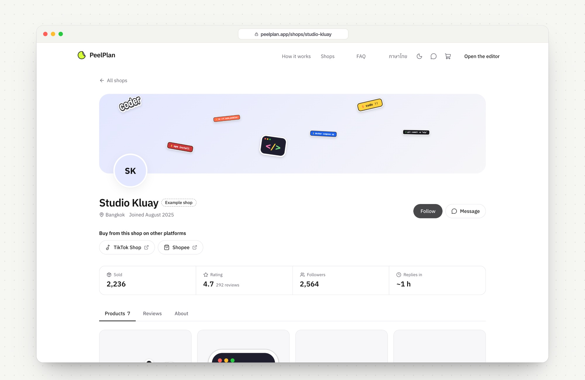
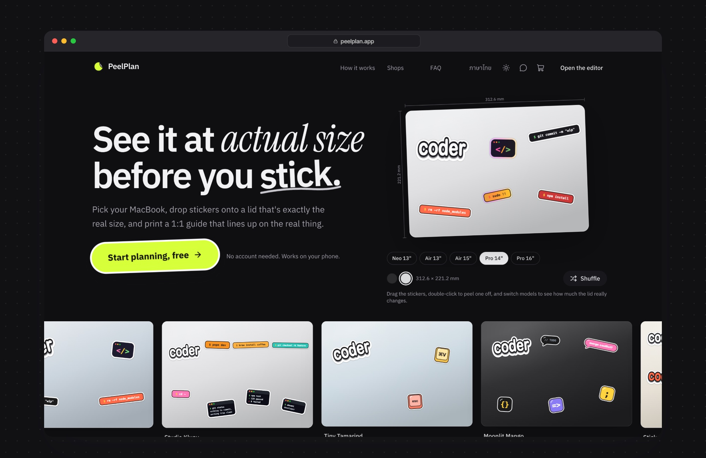
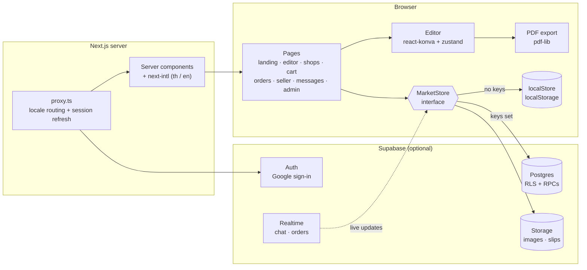
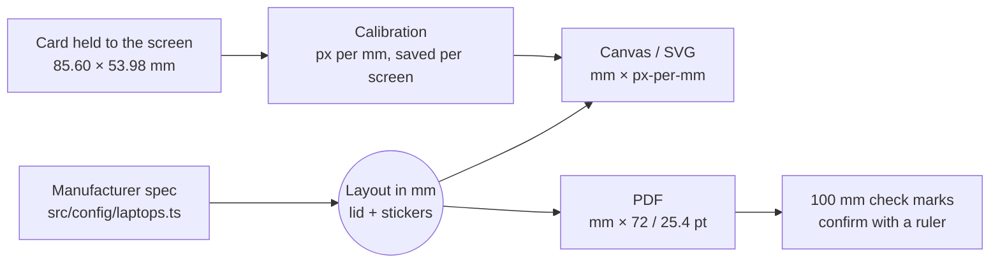
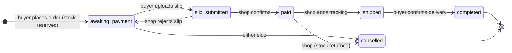
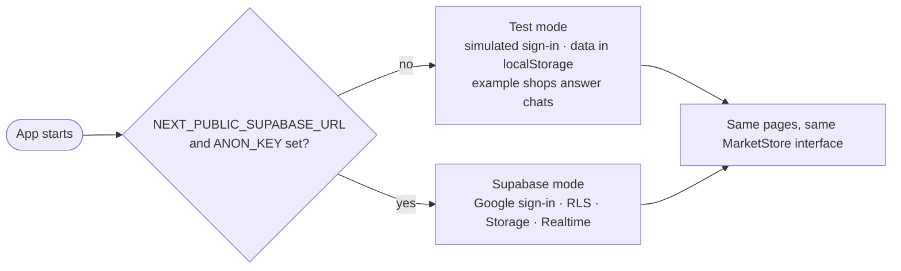

<div align="center">


# PeelPlan

### See it at actual size before you stick.

Plan laptop stickers on a true 1:1 MacBook lid, try stickers from independent shops,<br />
and print a placement guide that lines up on the real lid to within ±1 mm.

<p>
  
  
  
  
  
  
</p>



</div>

<br />

## Why PeelPlan

A sticker that looked small on a shop page turns out to cover the logo. A layout that worked in your head runs off the edge. PeelPlan draws every lid from the manufacturer's real dimensions and keeps every sticker in millimetres, so what you see on screen is what you get on the lid.

<table>
  <tr>
    <td width="33%" valign="top"><h4>True 1:1 lids</h4>Every MacBook Neo, Air and Pro lid is stored in millimetres with its source cited. Calibrate once with any bank or ID card and the lid on screen is the lid on your desk.</td>
    <td width="33%" valign="top"><h4>A real editor</h4>Drag, scale with a live mm readout, rotate, flip, layer, lock and multi-select. Snap guides, plus warnings for overlaps, the logo and stickers near the edge.</td>
    <td width="33%" valign="top"><h4>Your own stickers</h4>Photograph a sticker, remove the background in the browser, add a die-cut border, and set its real size by typing it or marking a card in the photo.</td>
  </tr>
  <tr>
    <td valign="top"><h4>Print and stick</h4>A 1:1 vector PDF with 100 mm check marks, A4 or Letter tiling, a ruler on every sheet and a cut-out template. Lay it on the lid and stick through the outlines.</td>
    <td valign="top"><h4>Sticker shops</h4>Sellers list stickers with exact sizes. Buyers try them on their lid, pay the shop directly by PromptPay QR, upload the slip and chat. Shops can link TikTok Shop, Shopee and Lazada.</td>
    <td valign="top"><h4>Runs without a backend</h4>No keys needed to try everything: accounts, shops, orders, chat and admin run in test mode in the browser. Add Supabase keys and the same screens use the database.</td>
  </tr>
</table>

<br />

## A look around


<p align="center"><sub><b>Editor.</b> The library, millimetre rulers, and every layer listed with its real size.</sub></p>

<br />

<table>
  <tr>
    <td width="50%"></td>
    <td width="50%"></td>
  </tr>
  <tr>
    <td align="center"><sub><b>Shops.</b> Every shop is shown as a lid with its own stickers.</sub></td>
    <td align="center"><sub><b>Shop page.</b> Products at real size, PromptPay checkout and links out.</sub></td>
  </tr>
</table>

<br />


<p align="center"><sub><b>Dark mode.</b> Same lid, lit for a dark room.</sub></p>

<br />

## Architecture

PeelPlan is one Next.js app. Pages are server-rendered and translated with next-intl. Anything that needs data talks to a **store interface**, and the store decides where the data lives: in the browser (test mode) or in Supabase.



### From millimetres to the screen and the printer

Every size in the app is stored in millimetres. Pixels and points only exist at the moment something is drawn, and one module (`src/lib/scale.ts`) does every conversion.



### Ordering and paying

PeelPlan never holds money. The buyer pays the shop's own PromptPay QR and uploads the slip. Each side can only make the moves below; the same rules are enforced in `NEXT_STATUS` (client) and in `set_order_status` (database).



### Test mode or Supabase



<br />

## Getting started

```bash
pnpm install
pnpm dev          # http://localhost:3000
```

No keys are needed. Without Supabase everything runs in test mode in your browser, so you can play buyer and seller on one device.

```bash
pnpm test         # unit tests (Vitest)
pnpm typecheck
pnpm lint
pnpm build
```

<br />

## Project structure

```
src/
├─ app/[locale]/        pages: landing, editor, shops, cart, checkout, orders,
│                       seller, messages, admin, feedback, legal
├─ config/              laptops.ts (lid geometry + sources), references.ts (card / coin sizes)
├─ lib/                 scale · geometry · snap · placement · warnings · pdf/ · image/   (tested)
├─ features/
│  ├─ editor/           editor store, persistence and UI
│  ├─ market/           types, PromptPay QR, localStore + supabaseStore
│  ├─ chat/             buyer ↔ shop messaging
│  ├─ admin/            admin data helpers
│  ├─ analytics/        cookieless first-party visit stats
│  └─ feedback/         problem / suggestion form
├─ components/          header, logo, LidArt, landing sections
├─ stickers/            original in-house SVG sticker packs
└─ messages/            en.json, th.json (+ key parity test)

demo-assets/stickers/   demo-only character PNGs, served only when NEXT_PUBLIC_DEMO_ASSETS=true

supabase/migrations/
├─ 0001_profiles_shops.sql             accounts, onboarding, shop applications
├─ 0002_marketplace.sql                products, orders, slips, chat, storage
└─ 0003_admin_analytics_feedback.sql   admin role, visit stats, feedback
```

<br />

## Tech stack

| Area | Choice |
|---|---|
| App | Next.js 16 (App Router, Turbopack), React 19, TypeScript |
| Styling | Tailwind CSS 4 with CSS-variable themes (light and dark) |
| Editor | react-konva, zustand |
| PDF | pdf-lib |
| Motion | GSAP ScrollTrigger and CSS sticky scenes; Lenis on mouse and trackpad only |
| i18n | next-intl |
| Backend | Supabase: Postgres with row-level security, Google Auth, Storage, Realtime |
| Tests | Vitest |

<br />

## Setting up the real backend

<details>
<summary><b>1. Accounts: Google sign-in and onboarding</b></summary>

<br />

1. Create a Supabase project. Put the Project URL and anon key in `.env.local` as `NEXT_PUBLIC_SUPABASE_URL` and `NEXT_PUBLIC_SUPABASE_ANON_KEY`.
2. Run `supabase/migrations/0001_profiles_shops.sql` in the SQL editor, or `supabase db push`.
3. In Google Cloud Console, create an OAuth client (type: Web) and add the redirect URI Supabase shows under Authentication → Providers → Google.
4. Enable the Google provider in Supabase with that client ID and secret.
5. Under Authentication → URL Configuration, allow `http://localhost:3000/auth/callback` and your production URL.

Writes with rules (birth date, consent, shop application) go through the `complete_onboarding` RPC. The public shop directory is the `shops_public` view, which never exposes owner names. `delete_my_account()` covers the right to erasure. Age rules (13+ to register, 20+ to own a shop) are enforced in the server action and by database triggers.

</details>

<details>
<summary><b>2. Marketplace: shops, PromptPay orders and chat</b></summary>

<br />

1. Run `supabase/migrations/0002_marketplace.sql`. It adds products, orders, order items and events, chat threads and messages, and reports, all with row-level security. Orders, slips and chat go through RPCs (`place_order`, `set_order_status`, `submit_slip`, `open_thread`, `send_message`, `mark_thread_read`) that check stock and compute totals on the server.
2. It creates four Storage buckets: `product-images` and `shop-images` (public, owner writes) and `slips` and `chat-images` (private, signed URLs for the two parties only).
3. It adds `messages`, `threads` and `orders` to the Realtime publication.
4. Optional, with `pg_cron`: schedule `expire_unpaid_orders()` (3 days) and `purge_closed_orders()` (1 year after closing).

</details>

<details>
<summary><b>3. Admin, visitor statistics and feedback</b></summary>

<br />

1. Run `supabase/migrations/0003_admin_analytics_feedback.sql`.
2. Make yourself an admin from the SQL editor; the app has no way to grant it:
   ```sql
   update public.profiles set is_admin = true where id = '<auth user uuid>';
   ```
3. `/admin` shows visitors, shop approvals, feedback and chat reports.

Visitor statistics are first-party and cookieless: no IP addresses, no third-party scripts, and Do Not Track and Global Privacy Control are respected. Admins only receive aggregates. Schedule `purge_site_data()` to drop page views after 13 months and feedback after 2 years.

</details>

<details>
<summary><b>Deploying: site URL, headers and test mode</b></summary>

<br />

- `NEXT_PUBLIC_SITE_URL` is the public origin (for example `https://peelplan.app`). It is baked in at build time for canonical links, Open Graph tags, `sitemap.xml` and `robots.txt`. On Vercel the project's production domain is used when it is unset. Any other production build without it fails, so the site never ships pointing at `http://localhost:3000`; set `ALLOW_LOCAL_SITE_URL=1` (or build into `NEXT_DIST_DIR`) for a local check.
- Without `NEXT_PUBLIC_SUPABASE_URL` and `NEXT_PUBLIC_SUPABASE_ANON_KEY` the app runs in browser test mode with a simulated sign-in. Production builds and servers print a warning when that happens.
- `next.config.ts` sends security headers on every route: a Content-Security-Policy (self, the Supabase origin and its Realtime socket, `frame-ancestors 'none'`), `X-Frame-Options: DENY`, `nosniff`, a strict referrer policy and a Permissions-Policy that turns off camera, microphone and location. Scripts allow `'unsafe-inline'` for Next's inline payload and the pre-paint theme script.

</details>

<details>
<summary><b>Demo-only artwork</b></summary>

<br />

`NEXT_PUBLIC_DEMO_ASSETS=true` in the gitignored `.env.local` turns on an Apple-style lid logo and third-party character stickers for private mockups. They are trademarked or copyrighted, so leave the variable unset on any public deployment; example lids then use PeelPlan's own stickers. The screenshots above are taken with it off.

The character PNGs live in `demo-assets/stickers/`, outside `public/`. `/stickers/demo/<file>.png` serves them only when the variable is on and answers 404 otherwise.

</details>

<br />

## Before launch

- [ ] Measure corner radius and logo position on real units and update the values marked `verified: false` in `src/config/laptops.ts`.
- [ ] Confirm with a ruler that each lid face matches the manufacturer's footprint.
- [ ] Embed a Thai font in the PDF export (`@pdf-lib/fontkit`).
- [ ] Replace the example shops and reviews with real sellers.
- [ ] Add the contact email on the legal pages.

<br />

---

<p align="center"><sub>MacBook is a trademark of Apple Inc., used only to name lid sizes. PeelPlan is not affiliated with Apple.</sub></p>
